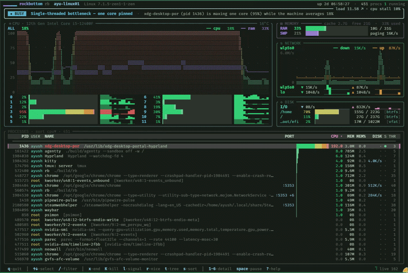

# rockbottom

**A terminal system monitor that reads the numbers for you.** One sentence at
the top says whether your computer is fine and, if it isn't, which process is to
blame. Linux and macOS, one binary, MIT.

<p>
  <a href="https://github.com/1ay1/rockbottom/actions/workflows/ci.yml"></a>
  <a href="https://github.com/1ay1/rockbottom/releases/latest"></a>
  <a href="LICENSE"></a>
</p>

<p>
  
</p>

[Releases](https://github.com/1ay1/rockbottom/releases) ·
[Issues](https://github.com/1ay1/rockbottom/issues)

## Install

```sh
curl -fsSL https://raw.githubusercontent.com/1ay1/rockbottom/master/install.sh | sh
rb
```

The installer downloads the release for your machine, checks its SHA-256, puts
`rb` in `~/.local/bin` and adds that directory to the startup files for Bash,
zsh, fish and login `sh`. Open a new terminal and run `rb`.

Prebuilt binaries: Linux x86_64 and arm64, and macOS on Apple Silicon. The Linux
binary is fully static (musl): no shared libraries and no glibc version floor,
so it runs on any Linux kernel of its architecture. On an Intel Mac,
[build from source](#building). The
[release page](https://github.com/1ay1/rockbottom/releases/latest) has the
standalone binaries and checksums for a manual install.

## The verdict

`htop` and `btop` show you the numbers. rockbottom reads them and answers "is my
computer okay?" at the top of the screen:

```
╭───────────────────────────────────────────────────────────────╮
│ ▲ Working hard — CPU is heavily loaded   chrome (pid 4160) …  │
╰───────────────────────────────────────────────────────────────╯
```

It's colour coded, so you can tell at a glance whether you need to care:

| Verdict | Meaning |
|---|---|
| **Calm** | Nothing to do. |
| **Busy** | Something is working, and that's allowed. |
| **Stressed** | Look at the process it named. |
| **Critical** | Time to close some things. |

The process responsible is marked `»` and highlighted in the list, so you don't
have to hunt for it.

Under the verdict, Linux **PSI pressure chips** show how long tasks sat waiting
on CPU, memory or I/O (`/proc/pressure`): "tasks stalled on I/O 40% of the last
10s" is the kernel telling you where the bottleneck is. When the disk is the
bottleneck, the verdict names the process doing the I/O.

## The main screen

- **CPU**: total load, every core, and a load graph.
- **Memory**: RAM and swap, with the used / cache / available split. Linux keeps
  free memory busy as cache, so "available" is the number that matters.
- **Disk**: read and write speed, and your drives, fullest first (btrfs
  subvolumes counted once).
- **Network**: download and upload per interface, with graphs.
- **Processes**: select, filter, sort and end processes. `●` marks a process
  that's working, `◆` one blocked on disk.
- **Per-process disk I/O**: from `/proc/<pid>/io`; sort by it with `i`.
- **Ports**: which program holds `:8080` (`:8080 +2` when it holds more), so an
  "address already in use" takes one look. Sort by it with `o`.
- **Battery**: charge in the corner, on laptops and phones.

## Detail panes

Press a number (or click a panel) for a full-screen pane with a system strip at
the top and a plain-language reading at the bottom. `Esc` backs out one layer;
number keys switch panes directly.

- **`1` CPU**: load over time, total and iowait, the 1/5/15 load averages read
  against your core count ("oversubscribed: tasks are waiting for a free core"),
  temperature, a distribution strip that catches a single-threaded process
  pinning one core, and every core with its clock. On Linux it reads the kernel's
  thermal-throttle counters, clock cap and cooling state, so a laptop that
  throttles at 70 °C is called out.
- **`2` Memory**: usage trend, used / cache / buffers / available, swap with a
  thrash detector, memory pressure, and the processes using the most memory.
- **`3` Network**: totals, then every interface with live graphs, lifetime
  totals, a burst detector and link state. For wifi: the network name, band,
  link speed and signal strength (from nl80211, without running `iw`).
- **`4` GPU**: load over time, VRAM, temperature, power against its limit,
  clocks, fan, encode and decode load, the processes using VRAM, and a reading
  ("VRAM is nearly full"). NVIDIA (`nvidia-smi`), AMD and Intel, plus Mali and
  Adreno on phones and single-board computers. Anything a GPU doesn't report is
  left out rather than shown as `N/A`; several GPUs stack.
- **`5` Disk**: read/write graphs, I/O pressure with a bottleneck reading, every
  filesystem with its device, free space, type and a fullness meter, and the
  processes using the disk right now.
- **`6` / `Enter` Process**: the selected process in full: command line, CPU and
  memory with its rank among all processes, disk I/O, threads, run state in plain
  words ("uninterruptible: waiting on I/O, can't be killed"), owner and listening
  ports.
- **`7` Users**: per person rather than per process, for shared machines. Every
  user with their share of the CPU, RAM, process and thread count, I/O, zombies,
  live login sessions (`●2`), and disk usage, including users with no running
  processes. Disk usage comes from quotas when the filesystem has them, otherwise
  from a background scan under a time budget, shown as `≥112G` while it runs and
  `—` when nothing has measured it yet. `Enter` opens a user's dashboard, `/`
  filters the roster, `f` filters the process list to that user, and `X` / `K`
  ends every process they own after a `y`/`n` confirm. It refuses `root`, never
  touches `rb` itself, and follows the user by name, so a re-sort can't retarget
  the kill.

## Keys

| Key | Action |
|---|---|
| `↑↓` / `j k` | select a process |
| `g` / `G`, `PgUp` / `PgDn` | top / bottom, page up / down |
| `/` | filter by name or pid, or `user:` `state:` `port:` `cpu:` `mem:`, `!` negates |
| `^w` / `^u` | while filtering: delete the last term / clear it |
| `*` | pin the selected process to the top while the rest re-sorts |
| `t` | process tree ↔ flat list |
| `x` / `Del` | end the process (SIGTERM) |
| `K` | force-kill (SIGKILL) |
| `l` | send any signal |
| `r` | renice |
| `X` | end every process with this name |
| `y` / `n` | confirm / cancel a kill |
| `s` | cycle the sort column; `c` cpu · `m` mem · `i` i/o · `n` name · `P` pid · `o` port |
| `1`–`7` / `Enter` | open a detail pane |
| `p` / `Space` | pause / resume |
| `T` | theme picker |
| `?` / `h` | help |
| `q` / `Esc` | quit |

The mouse works too: click a row to select it, double-click to open it, click a
header to sort, right-click a process to end it, and the wheel scrolls lists and
panes.

### Themes

616 themes from [maya](https://github.com/1ay1/maya)'s registry: Catppuccin,
Gruvbox, Nord, Tokyo Night, Dracula, Solarized, Everforest, the Alacritty, iTerm
and Windows Terminal collections, and more. Press `T` and type. The picker docks
beside the live screen, so you judge a theme on the real process table (below
about 108 columns it's a centred card instead). rb remembers your choice.

## What it costs to run

A monitor that takes a large share of a core becomes part of the problem it's
describing, so rb is measured, not assumed:

| 1 s refresh, idle desktop | CPU (one core) | Memory |
|---|---:|---:|
| **rb** (reading the GPU) | **~3.9%** | **9 MB** |
| btop | ~1.6% | 38 MB |
| htop (no GPU) | ~0.7% | 6 MB |

btop uses less CPU than rb, and htop less than both; rb uses a quarter of btop's
memory and reads your GPU the whole time. If idle CPU is all you care about, use
htop. Measured on a 12-core i5-12400F with an RTX 4060, 120×30 terminal, median
of three 35-second runs. The rb row includes the `nvidia-smi` process. Against
0.5.0 on the same machine, 0.6.0 uses ~37% less CPU and ~3 MB less memory. The
btop and htop rows are from the 0.5.0 measurement.

Where the cost goes:

- **Drawing is cheap and flat.** maya repaints only the cells that changed; a
  frame takes ~1.2 ms and barely grows with the terminal (80×24 to 170×45 is
  3.4% to 4.1%). The process table builds only the visible rows, so 400
  processes or 40,000 cost the same.
- **Fast signals every tick, slow ones on their own cadence.** CPU, memory,
  network and disk rates refresh each second; filesystems, sensors, ports and
  the GPU are throttled and cached. `/proc` and sysfs files are opened once and
  re-read with `pread`. `nvidia-smi` runs as one long-lived loop, and its
  per-process query only while the GPU pane is open.
- **Expensive work only while you're looking.** The per-user disk scan runs only
  while the Users pane is open. A `/proc/<pid>/io` refusal is remembered rather
  than retried. Profiling cut a sample from 632k syscalls to 112k.
- **It opens immediately.** The first frame has real data in a few milliseconds;
  slow one-time probes (the Apple SMC sensor table, IOReport, Termux:API) run a
  tick later. On an M1 that took start-up from ~470 ms to ~7 ms.

Check it yourself: `rb --bench` times the sampler without the UI, and
`RB_PHASE=1 rb --bench` breaks the cost down per collector.

## Platform

rockbottom is an OS-independent core (the verdict, the update loop, the units)
on a platform backend, one directory per OS under `src/core/platform/`.

- **Linux** reads `/proc` and `/sys`: PSI pressure, per-core clocks, the iowait
  split, per-process disk I/O, thermal throttling. On Android (Termux) it uses
  Termux:API for battery and wifi.
- **macOS** uses `host_processor_info` / `host_statistics64` for CPU and memory,
  `sysctl` for swap, uptime and model, `libproc` for processes and ports, IOKit
  for disk throughput, GPU and battery, and `getifaddrs` for the network. PSI,
  the iowait split and per-core clocks have no macOS equivalent, so those fields
  are left out.

Windows isn't supported. There are no runtime dependencies, and rb sends nothing
anywhere.

**CPU clusters.** On Apple P/E cores, Intel hybrid Core/Atom and ARM
big.LITTLE, each CPU is labelled with its cluster and the grid groups by
cluster. It's probed once at start-up (sysfs `cpu_core` / `cpu_atom` and
`cpu_capacity` on Linux, `hw.perflevel*` on macOS); a machine needs a ~15%
capability spread before anything is called a cluster. `rb --topology` prints
what was detected:

```
model     Apple M1
logical   8
clusters  heterogeneous — 4 Performance + 4 Efficiency
```

## When a panel is empty

Every collector leaves its field blank when the data isn't there (a masked
`/sys`, an ioctl that needs root, no NVMe drive) and the rest keeps running.
`rb --doctor` says which collectors work and why the others don't:

```
  gpu        yes  1 adapter(s): Apple M1
  psi        no   no PSI — /proc/pressure absent (Linux <4.20, CONFIG_PSI=n, or
                  not Linux). Verdict falls back to load/iowait heuristics.
  ssd        no   no SMART data — NVMe admin ioctl needs root, or no NVMe device
```

It always exits 0. Paste its output into any bug report about a blank panel.
`rb --selfcheck` is the strict version: it runs the real collectors, checks the
data is sane (a non-empty process list, rb's own pid present, CPU between 0 and
1, used ≤ total) and exits non-zero if not. CI runs it on every platform.

## Under the hood

Every quantity has a type that knows its unit, so mixing up bytes and hertz
doesn't compile:

```cpp
using Bytes = Strong<BytesTag, std::uint64_t>;      // storage / memory
using Hertz = Strong<HertzTag, std::uint64_t>;      // clock speed
struct Ratio { double v; };                         // a proportion, clamped [0,1]
template <class Q> struct Rate { double per_sec; }; // Q, per second

// the one way to turn Bytes into Bytes per second
constexpr ByteRate rate(Bytes delta, double dt_sec) noexcept;
```

rockbottom is an Elm-style program: a `Model`, messages, one `update` per
message and a pure `view`. [maya](https://github.com/1ay1/maya) draws it, and
[jaal](https://github.com/1ay1/jaal), maya's runtime, runs the loop, timers and
background thread.

| Layer | Where | Role |
|---|---|---|
| Units | `src/core/units.hpp` | strong unit types, and the formatting (`4.2G`, `118M/s`) |
| Data | `src/core/metrics.hpp` | the `Snapshot` value types and the `Verdict` |
| Sampler | `src/core/sampler.*`, `verdict.cpp` | orchestration, deltas between ticks, the diagnosis |
| Platform | `src/core/platform/<os>/` | `linux/` reads `/proc` and `/sys`; `darwin/` uses mach, sysctl, libproc, IOKit |
| App | `src/ui/app.hpp` | `Model`, `Msg`, `update`, `view` |
| Widgets | `src/ui/widgets/` | panels, meters, graphs and the detail panes |

The program declares the effects it may use and the events it reads, and the
compiler enforces it: rb's list of effects is empty, so it can't set the
terminal title, touch your clipboard or write to scrollback. The background
sampler captures nothing and every value crossing the thread boundary is checked
as safe to send. Layouts are measured with maya's responsive toolkit, so the
screen holds together at any terminal size (see
[Responsive Layouts](third_party/maya/docs/15-responsive.md)).

## Building

C++26 (GCC 16+ or Clang 22+) and CMake 3.28+. C++26 is required: jaal uses
structured-binding packs (P1061). The submodules are recursive (maya carries
jaal); if one is missing, CMake says which.

**Linux:**

```sh
git clone --recurse-submodules https://github.com/1ay1/rockbottom
cd rockbottom
cmake -B build -DCMAKE_BUILD_TYPE=Release
cmake --build build -j
./build/rb
```

**macOS** (Apple Silicon or Intel) builds with Homebrew GCC:

```sh
brew install gcc cmake
git clone --recurse-submodules https://github.com/1ay1/rockbottom
cd rockbottom
cmake -B build -DCMAKE_BUILD_TYPE=Release   # picks Homebrew's newest g++
cmake --build build -j
./build/rb
```

Override the compiler with `-DCMAKE_CXX_COMPILER=g++-15` or `CXX=…`. Apple's
libc++ doesn't ship `std::move_only_function`, which maya needs, so macOS builds
use GCC; `src/core/platform/darwin/mach_util.hpp` makes Apple's kernel headers
parse under it.

Cloned without `--recurse-submodules`:

```sh
git submodule update --init --recursive
```

## License

MIT, see [LICENSE](LICENSE). The vendored maya and jaal are MIT too.
